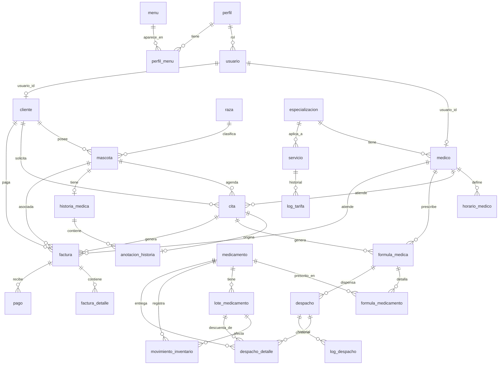

# Modelo de datos - Clinica Veterinaria (Entregable 1)

Este documento consolida el modelo de datos del sistema: el diagrama
entidad-relacion, la descripcion de las relaciones y restricciones de
integridad, y la justificacion de los cambios realizados sobre la estructura
inicial entregada por el docente.

Los scripts SQL de creacion y modificacion, organizados por fase, estan en
`docs/sql/`. Este documento ofrece la vista integral del modelo resultante.

## 1. Diagrama entidad-relacion

El siguiente diagrama esta escrito en formato Mermaid; GitHub lo renderiza
automaticamente. Tambien se incluye, en la seccion 4, la forma de obtener el
diagrama EER visual desde MySQL Workbench por ingenieria inversa.

## 2. Tablas del modelo

### Seguridad y acceso

- `usuario`: cuentas del sistema. Clave foranea `rol` hacia `perfil`.
- `perfil`: roles del sistema (Administrador, Recepcion, Medico, DESPACHO_MEDICO,
  Contable, JEFE_BODEGA).
- `menu`: catalogo de modulos de la aplicacion.
- `perfil_menu`: relacion muchos a muchos entre `perfil` y `menu`; define que
  modulos ve cada rol.

### Clientes, mascotas y medicos

- `cliente`: propietarios de las mascotas.
- `raza`: raza y especie de las mascotas.
- `mascota`: paciente. Pertenece a un `cliente` y a una `raza`.
- `especializacion`: especialidades medicas.
- `medico`: veterinarios. Pertenece a una `especializacion` y puede vincularse a
  un `usuario` (columna `usuario_id`).
- `horario_medico`: franjas de disponibilidad de cada medico.

### Citas y atencion

- `cita`: cita medica. Relaciona `cliente`, `mascota` y `medico`; tiene estado
  (PROGRAMADA, CONFIRMADA, ATENDIDA, CANCELADA, FINALIZADA).
- `historia_medica`: historia clinica de la mascota.
- `anotacion_historia`: cada atencion registrada en la historia; se vincula a la
  `cita` atendida.

### Formulacion

- `formula_medica`: cabecera de la formula; se relaciona con la `cita` y con el
  medico que la prescribe.
- `formula_medicamento`: detalle de la formula; un renglon por medicamento
  prescrito (dosis, frecuencia, duracion, cantidad, via).

### Inventario

- `medicamento`: catalogo del producto (codigo de 8 caracteres, registro Invima,
  precios de referencia, stock minimo, proximo pedido).
- `lote_medicamento`: lotes del medicamento (cantidad, precio de compra, fecha de
  vencimiento). La existencia del medicamento es la suma de sus lotes.
- `movimiento_inventario`: entradas y salidas, con usuario responsable y
  referencia al origen (carga masiva o despacho).
- `log_carga_inventario`: registro de cada proceso de carga masiva.

### Despacho

- `despacho`: cabecera de la dispensacion de una formula, con su estado.
- `despacho_detalle`: por medicamento, cantidad solicitada, entregada y lote.
- `log_despacho`: historial de cambios de estado del despacho.

### Servicios y facturacion

- `servicio`: catalogo de servicios o procedimientos con precio e IVA.
- `log_tarifa`: historial de cambios de precio e IVA de cada servicio.
- `datos_clinica`: datos de la clinica para la cabecera de la factura.
- `factura`: cabecera de factura (subtotal, IVA, descuento, total, estado de
  pago). Relaciona cita, cliente, mascota y medico.
- `factura_detalle`: items de la factura (servicios o medicamentos), con el valor
  conservado historicamente.
- `pago`: pagos registrados sobre una factura.

## 3. Relaciones y restricciones de integridad

Relaciones con llave foranea declarada en la base de datos:

- `lote_medicamento.medicamento_id` -> `medicamento.id`.
- `movimiento_inventario.medicamento_id` -> `medicamento.id`.
- `movimiento_inventario.lote_id` -> `lote_medicamento.id`.
- `formula_medicamento.formula_id` -> `formula_medica.id`.
- `formula_medicamento.medicamento_id` -> `medicamento.id`.
- `servicio.especializacion_id` -> `especializacion.id`.
- `log_tarifa.servicio_id` -> `servicio.id`.
- `factura_detalle.factura_id` -> `factura.id`.
- `pago.factura_id` -> `factura.id`.
- `despacho.formula_id` -> `formula_medica.id`.
- `despacho_detalle.despacho_id` -> `despacho.id`.
- `horario_medico.medico_id` -> `medico.id`.
- `perfil_menu.perfil_id` -> `perfil.perfil_id`; `perfil_menu.menu_id` -> `menu.menu_id`.
- `usuario.rol` -> `perfil.perfil_id`.

Relaciones validadas a nivel de aplicacion (sin FK formal, por compatibilidad
con los datos existentes del docente): `medico.usuario_id` -> `usuario.id`,
`factura.cita_id/cliente_id/mascota_id/medico_id`, y las referencias por
identificador en el despacho hacia medicamento y lote. El backend verifica la
existencia de los registros antes de operar.

Reglas de integridad relevantes:

- No se eliminan registros fisicamente: las entidades usan banderas de estado
  (`activo`, `estado`, `estado_pago`) para desactivar o anular, conservando el
  historial.
- La existencia de inventario nunca es negativa; el descuento solo ocurre al
  confirmar un despacho, de forma transaccional.
- El valor de las tarifas se conserva historicamente en `factura_detalle`.
- Los cambios de estado y de tarifa quedan registrados en tablas de log.

## 4. Como obtener el diagrama EER en MySQL Workbench

Para el entregable se recomienda adjuntar tambien el diagrama EER visual
generado por MySQL Workbench mediante ingenieria inversa sobre la base de datos
ya creada:

1. Abra MySQL Workbench y conecte al servidor donde esta la base `clinica`.
2. Menu `Database` -> `Reverse Engineer...` (atajo Ctrl+R).
3. Seleccione la conexion y presione `Next` hasta elegir el esquema `clinica`.
4. Seleccione los objetos a importar (todas las tablas) y finalice.
5. Workbench genera el diagrama EER con todas las tablas y sus relaciones.
6. Acomode las tablas y exporte el diagrama con `File` -> `Export` ->
   `Export as PNG...` (o `Export as Single Page PDF...`) para adjuntarlo.

De esta forma, el diagrama refleja exactamente la estructura resultante tras
ejecutar todos los scripts de `docs/sql/`.

## 5. Justificacion de los cambios (resumen)

La estructura inicial contenia unicamente la tabla `medicamento` con campos
basicos. El sistema se amplio para cubrir los procesos de inventario, citas,
atencion, formulacion, facturacion, reportes y despacho:

- Inventario: separacion `medicamento` / `lote_medicamento` para manejar varios
  lotes con distinto precio y vencimiento; `movimiento_inventario` para la
  trazabilidad; codigo, Invima, precios y stock minimo en `medicamento`.
- Citas: `horario_medico` para la disponibilidad y `medico.usuario_id` para el
  calendario por veterinario autenticado.
- Atencion y formulacion: `formula_medicamento` para formulas de varios
  medicamentos; columnas clinicas en `anotacion_historia`.
- Servicios y facturacion: `servicio`, `log_tarifa`, `factura`,
  `factura_detalle`, `pago` y `datos_clinica` para el proceso comercial con
  historial de tarifas y estados de pago.
- Despacho: `despacho`, `despacho_detalle` y `log_despacho` para separar la
  formulacion de la entrega, afectando el inventario solo al dispensar.
- Seguridad: uso de `perfil`, `menu` y `perfil_menu` para el control de acceso
  por rol, ampliado con los perfiles DESPACHO_MEDICO, Contable y JEFE_BODEGA.

El detalle y la justificacion especifica de cada cambio estan en los scripts
correspondientes dentro de `docs/sql/`.
